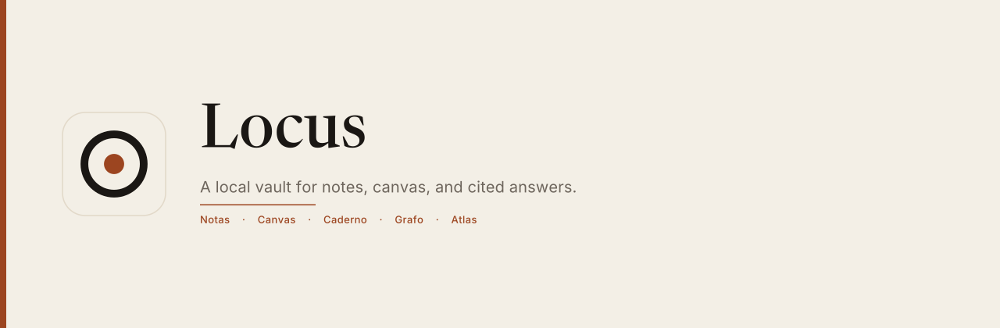
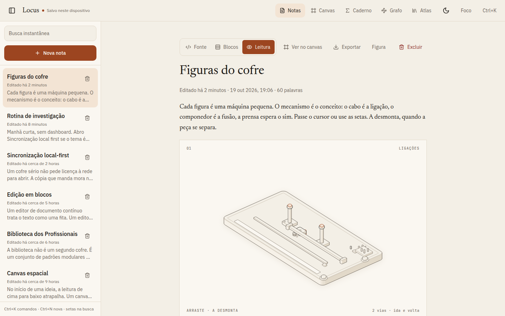
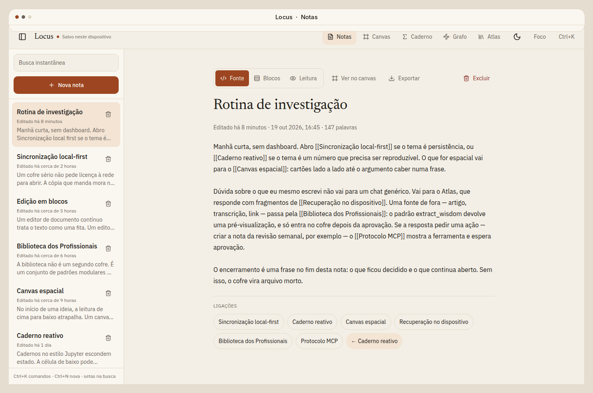
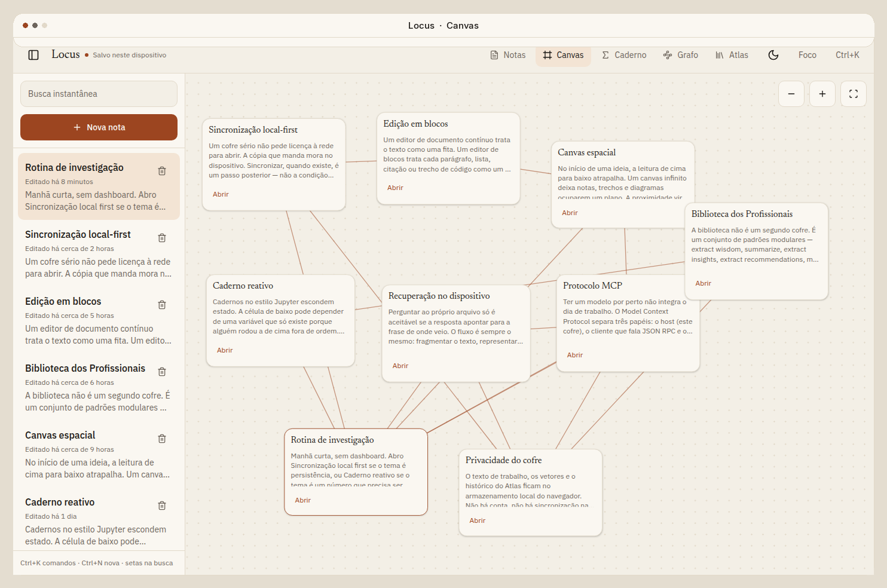
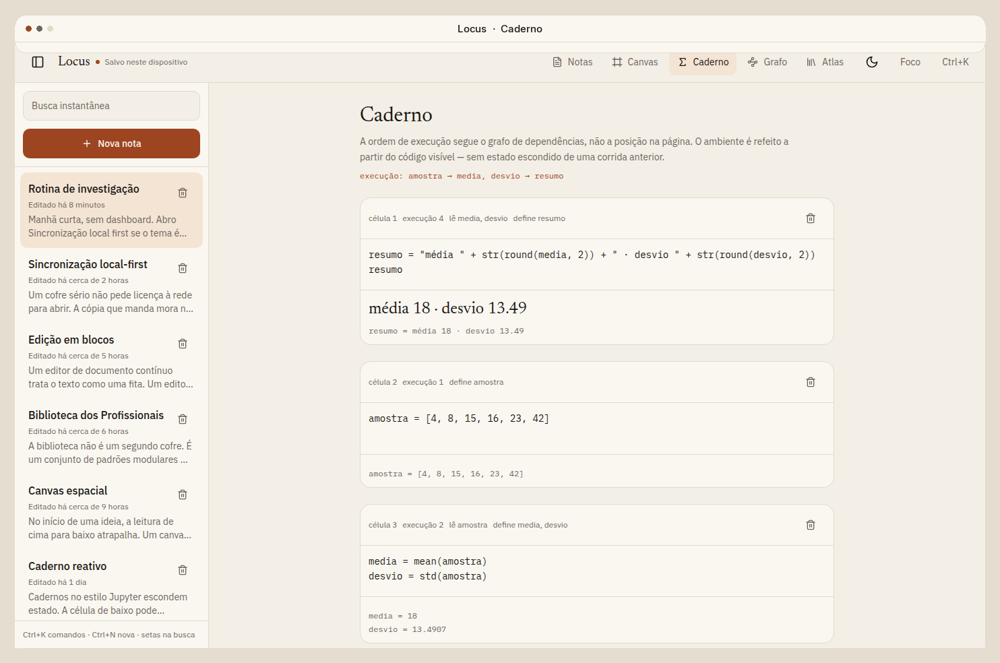
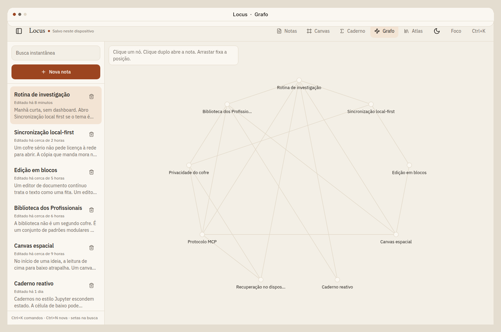
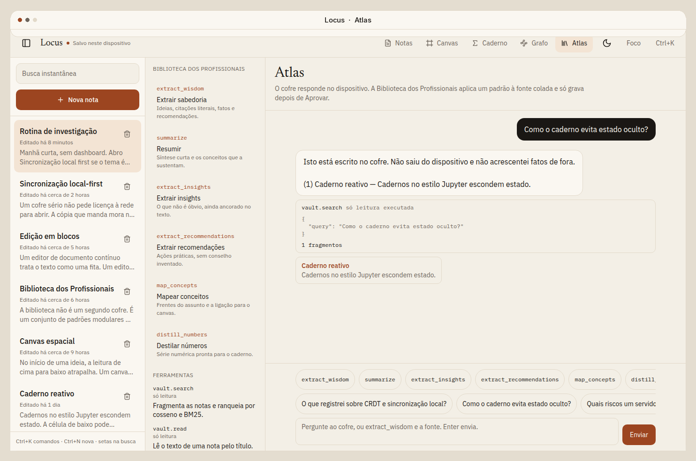
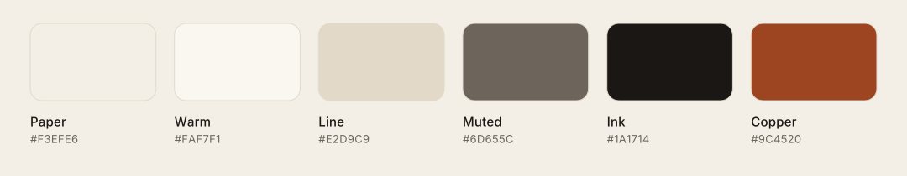
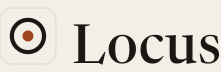

A local vault for linked notes. The text stays in the browser.

[](https://locus-brown-delta.vercel.app)
[](https://locus-brown-delta.vercel.app)

[](https://www.typescriptlang.org/)
[](https://react.dev/)
[](https://tanstack.com/start)
[](https://vite.dev/)

## Overview

Locus is a writing desk for one device. Notes are markdown. `[[wikilinks]]` connect them. The same notes can sit on a canvas, feed a small reactive notebook, or answer a question in Atlas with the passage they came from.

There is no account. The vault is stored in the browser. Export is a markdown file you download on purpose.

The interface is in Portuguese.

## Em português

Locus é um cofre de notas que mora no navegador. Você escreve em markdown, liga as notas com `[[wikilinks]]`, espalha as mesmas notas num canvas, roda um caderno que executa pela dependência e pergunta ao Atlas. A resposta aponta o trecho de onde veio. Sem conta e sem nuvem: o texto fica neste dispositivo, e exportar é um arquivo markdown.

## Features

- **Notes.** Source, block, and reading modes. Blocks can be reordered. Wikilinks open the matching note.
- **Canvas.** Each card is a whole note. Moving it does not copy the text. Lines follow the same `[[wikilinks]]`.
- **Notebook.** A small interpreter (`mean`, `std`, `chart`, and the rest) runs cells by dependency, not by screen order.
- **Graph.** Wikilinks drawn as a graph. Drag a node to pin it.
- **Atlas.** Local retrieval over the vault (n-gram vectors and BM25) with citations. Pattern tools such as `extract_wisdom` preview a note and write only after you approve.
- **On this device.** Search, theme, focus mode, and the command palette (`Ctrl+K` or `⌘K`). New note is `Ctrl+N`.
- **Figures.** A note can hold an interactive instrument. The syntax is `![[figure:wikilinks]]`, or `![[figure:embeddings|sticker]]` for a small card.

## Figures

A figure is a small machine whose working is the idea: a patch bay for wikilinks, a composing stick for a merge, a press that waits for approval. Hover or the arrow keys move it. `A` takes it apart, where the machine comes apart. An unknown slug stays in the note and says so. Nothing is fetched.

Insert one with the **Figura** button, or from the command palette. The sample note **Figuras do cofre** holds the pack. **Edição em blocos** carries a sticker.

The drawings are [Anatomy](https://github.com/wheresryan22/anatomy) figures (MIT, Ryan), vendored at `.agents/skills/anatomy` with that license. This pack is SVG only, in the light Locus palette. WebGL and the 3D turn mode are not used. Generated example HTML and PDFs are left out; `node examples/<name>/build.mjs` in that folder rebuilds them.

| Slug | Machine |
| --- | --- |
| `wikilinks` | Patch bay. One cord, two lamps. |
| `crdt` | Composing stick. Two slugs, no referee. |
| `embeddings` | Comparator. The score stays on the bench. |
| `notebook` | Balance train. Order follows dependency. |
| `atlas` | Fiche reader. The finger lands on a real line. |
| `canvas` | Drafting board. A card moves, the sheet does not copy. |
| `approval` | Press. The platen waits for the lever. |
| `local-vault` | Desk safe. Export is the slip drawer. |



## Interface

Captured from the running app. The window frame is only for this page.











## Palette

Taken from the app theme in `src/styles.css`.



| Name | Hex | Role |
| --- | --- | --- |
| Paper | `#F3EFE6` | Page |
| Warm | `#FAF7F1` | Raised surface |
| Line | `#E2D9C9` | Hairline |
| Muted | `#6D655C` | Secondary text |
| Ink | `#1A1714` | Text |
| Copper | `#9C4520` | Accent |

Dark theme swaps the same roles: paper `#12100E`, ink `#F3EEE6`, copper `#E39462`.

The mark is the ring and copper point from `public/favicon.svg`.



## Stack

React 19, TanStack Start and Router, Vite, Tailwind CSS 4, Radix, Zustand. The vault itself is client state persisted to `localStorage`.

Postgres is optional and unused by the notes. With `DATABASE_URL`, server code uses `pg`. Without it, an in-memory PGLite database can apply `migrations/*.sql`. The Better Auth schema lives in `migrations/auth/` and is not applied to the note vault. Sign-in is off (`config/app-env.json` sets `VITE_AUTH_ENABLED` to `false`).

Atlas can call the xAI API when `XAI_API_KEY` is set. Without that key, pattern extraction stays on the local path.

## Getting started

The live app is at [locus-brown-delta.vercel.app](https://locus-brown-delta.vercel.app). Every push to `main` redeploys it.

To run a copy locally, Node.js 22.

```bash
npm install
npm run dev
```

Open [http://localhost:8080](http://localhost:8080). The sample vault is already there.

```bash
cp .env.example .env   # optional
npm test
npm run typecheck
npm run build
```

| Script | What it does |
| --- | --- |
| `dev` | Vite on `0.0.0.0:8080`, with `config/app-env.json` applied |
| `build` | Production build, then `db:migrate` |
| `db:migrate` | Applies `migrations/*.sql` when `DATABASE_URL` is set. Skips otherwise |
| `preview` | Serves the production build |
| `test` | Migration, auth-flag, and library tests |
| `typecheck` | `tsc --noEmit` |
| `lint` / `format` | ESLint and Prettier |

`scripts/grok-pwa-plugin.test.mjs` is the platform install-page suite. It assumes a blank template title, so it is not part of `npm test` once the app is named Locus and ships `public/og.jpg`.

## Project structure

```
src/components/locus/   notes, canvas, notebook, graph, atlas
src/lib/vault/          store, markdown, notebook, retrieval, patterns
src/lib/auth/           optional Better Auth, off unless you turn it on
src/lib/db.ts           PGLite fallback or Postgres via DATABASE_URL
src/routes/             TanStack Start routes
migrations/auth/        Better Auth tables, opt-in
config/app-env.json     build flag: auth disabled
public/                 favicon and share card
.github/assets/         mark, wordmark, banner, palette
```

## Roadmap

The sample notes talk about CRDT sync, WebGPU embeddings, and a larger notebook runtime. Those are essays in the vault, not the engine that stores it. Today the copy that matters is `localStorage` on this browser.

What the app already draws a line toward:

- Sync between devices without giving up the local copy
- Embeddings that stay on the device
- A license, when the author chooses one

## Author

[Wellington Vieira De Souza](https://github.com/souzawellington)

## License

This repository does not include a license. All rights stay with the author until one is added.
